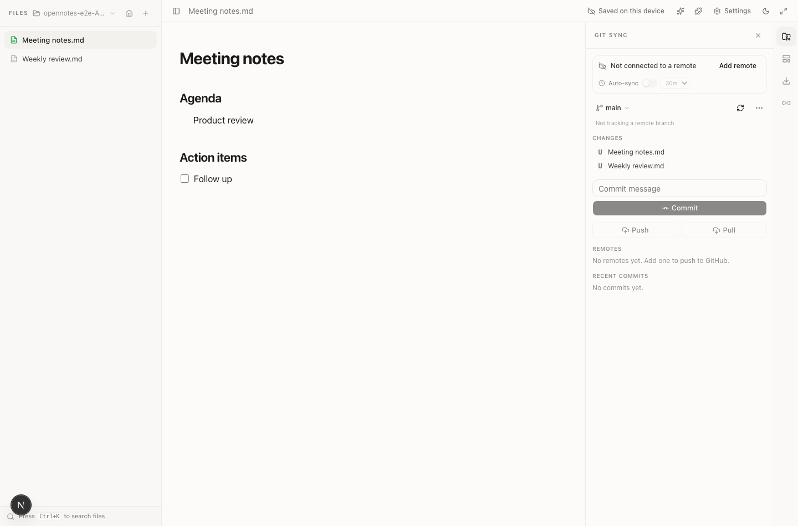

# OpenNotes

**A Mac-first markdown notes app for people who want real files, local git sync, and opt-in AI.**

OpenNotes is a local-first workspace for plain `.md` notes. The Mac app writes to a folder you choose, syncs through your own git setup, and keeps AI optional and under your keys. There is no OpenNotes account, backend, telemetry, or token custody.

[](https://github.com/harshmathurx/OpenNotes/actions/workflows/ci.yml)
[](https://github.com/harshmathurx/OpenNotes/releases/latest)
[](LICENSE)
[](CONTRIBUTING.md)



## Status

OpenNotes is usable, pre-1.0 software. The core editor, local storage, bundled extensions, and Mac desktop shell work today. The app is still unsigned and not notarized, so macOS shows a first-open warning. Expect sharp edges around packaging, the extension directory, and broader distribution.

## Download

Get the latest Mac build from [GitHub Releases](https://github.com/harshmathurx/OpenNotes/releases/latest).

Current releases ship as DMGs:

- Apple Silicon: `OpenNotes_<version>_aarch64.dmg`
- Intel: planned in the release workflow, not always attached to early releases

After installing, drag `OpenNotes.app` into Applications. Because the app is not yet Apple-notarized, first launch requires **right-click → Open → Open**. See [RELEASE.md](RELEASE.md) for the safe install path and signing status.

The browser build (`pnpm dev`) is useful for development and preview. The Mac app is the product surface for real files on disk, git sync, and Keychain-backed secrets.

## Why OpenNotes exists

Most note apps ask you to compromise on at least one layer:

- Your notes are not normal files.
- Sync depends on a vendor account.
- AI requires sending content through someone else's product path.
- Extensions are powerful but opaque, or safe but too limited.

OpenNotes takes the boring position: notes should be files, sync should use tools you already trust, and AI should be off until you choose otherwise.

## What works now

| Area           | Current behavior                                                                                                         |
| -------------- | ------------------------------------------------------------------------------------------------------------------------ |
| Editor         | Tiptap live-markdown editing, slash menu, wikilinks, bubble menu, zen mode, command palette (`Cmd+K`), light/dark themes |
| Workspace home | Daily journal, scratchpad, kanban, recent notes (`Cmd+Shift+H`)                                                          |
| Styling        | Font, size, leading, and canvas width controls, persisted locally                                                        |
| Local storage  | IndexedDB in the web build; real `.md` files in the Mac app                                                              |
| Extensions     | Templates, Export, Backlinks, AI Co-Writer, Git Sync                                                                     |
| Git sync       | Uses the local git binary and your existing SSH/agent credentials in the Mac app                                         |
| AI             | Bring your own Anthropic/OpenAI key or local Ollama; off by default                                                      |

## Where data lives

- Notes: IndexedDB in the browser build; a folder you choose in the Mac app.
- Git credentials: your local git and SSH/agent setup. OpenNotes does not hold a GitHub token.
- AI keys: encrypted on device. The Mac app stores secrets in the macOS Keychain.
- Telemetry: none.

Clearing browser site data removes browser-stored notes from that profile. If the notes matter, use the Mac app with a real folder or keep an independent backup.

## Extensions

OpenNotes keeps the center small. Capabilities live as extensions: a manifest plus `activate(ctx)` that registers commands, slash items, and panels. Bundled extensions use the same public contract contributors use.

Start here:

- [Extension guide](docs/extensions.md)
- Starter template: [`extensions/_starter`](extensions/_starter)
- Built-in references: [`extensions/templates`](extensions/templates), [`extensions/backlinks`](extensions/backlinks), [`extensions/export`](extensions/export), [`extensions/gitSync`](extensions/gitSync)

Extensions are statically imported today. A curated community extension directory is on the roadmap.

## Project map

- `app/` and `components/`: Next.js app shell and UI
- `core/`: editor, vault, storage, git, AI, registry, and bridge logic
- `extensions/`: bundled extensions and starter template
- `src-tauri/`: macOS desktop shell and native commands
- `tests/`: unit and end-to-end coverage
- `.github/`: CI, release workflow, issue templates, CODEOWNERS, Dependabot

For a fuller maintainer map, see [docs/architecture.md](docs/architecture.md).

## Local development

```bash
corepack enable
pnpm install
pnpm dev
```

Open http://localhost:3000.

For the Mac app:

```bash
pnpm tauri:dev
```

You will need the Tauri macOS toolchain installed. The desktop app is the only surface that can use real folders, local git, and Keychain secrets.

## Validation

Run the checks that match your change:

```bash
pnpm run typecheck
pnpm run lint
pnpm exec vitest run
pnpm run build
```

For desktop changes:

```bash
cargo check --manifest-path src-tauri/Cargo.toml
```

## Contributing

Contributions are welcome, especially small fixes, extension ideas, and reliability work around files, sync, export, and desktop behavior.

- Start with [CONTRIBUTING.md](CONTRIBUTING.md).
- Report security issues privately via [SECURITY.md](SECURITY.md).
- For general help, see [SUPPORT.md](SUPPORT.md).
- Maintainer expectations live in [GOVERNANCE.md](GOVERNANCE.md).

## Roadmap

1. Harden Mac app packaging, signing, and notarization.
2. Ship a curated community extension directory.
3. Improve import/export and folder-backed workflows.
4. Add optional storage providers only where users keep control.
5. Polish the browser build as a preview/PWA surface.

## License

[Apache-2.0](LICENSE)
