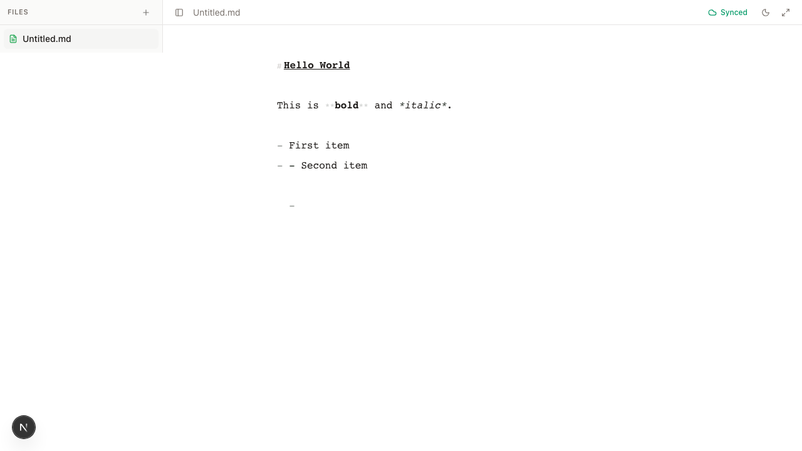

# OpenNotes

**Your notes. Real files. Your storage. Your AI.**

OpenNotes is a calm, open-source, local-first markdown workspace. Your notes stay plain `.md` files, sync runs through infrastructure you already own, and AI is opt-in on your own keys. No account, no backend, no telemetry.

[](LICENSE)
[](CONTRIBUTING.md)
[](https://www.inkandswitch.com/local-first/)
[](https://github.com/harshmathurx/OpenNotes/releases)

<!-- Hero image: screenshots/final-02-editor-content.png must exist in the repo (it is committed).
     If a designed hero is added later at docs/design/hero.png, swap the src below. -->


## Download

Get the OpenNotes Mac app (Apple Silicon or Intel) from the [Releases page](https://github.com/harshmathurx/OpenNotes/releases).

**The web app** — you can also open OpenNotes in a browser. There is no hosted deployment yet: run it locally (see [Local development](#local-development) below) or self-host it from [this repo](https://github.com/harshmathurx/OpenNotes).

The Mac app is not yet signed with an Apple certificate, so macOS will warn on first open — right-click → Open → Open to proceed. Signing is on the roadmap (see RELEASE.md).

## Why OpenNotes

Most note tools ask you to give up at least one of three things: your files, your sync, or your AI. OpenNotes is built on the position that you shouldn't have to give up any of them.

- **Files** — notes are plain markdown. Obsidian gets this right but is closed source; Notion holds content on its servers.
- **Sync** — git, through your own local git and credentials. No hosted sync service, no subscription.
- **AI** — opt-in, on your own Anthropic/OpenAI key or a local Ollama model. Keys are encrypted on device and never touch a server.

The bet: a small, excellent core plus a clean extension API beats a bloated app.

## What works now

- **Editor** — Tiptap live-markdown editing, slash menu, wikilinks, bubble menu, zen mode, command palette (`Cmd+K`), light/dark themes.
- **Workspace Home** (`Cmd+Shift+H`) — daily journal, scratchpad, kanban, recent notes.
- **Styling Studio** — font, size, leading, and canvas width, applied instantly and persisted locally.
- **Local-first storage** — every keystroke lands in IndexedDB first; works offline; no account required.
- **Extensions** — bundled: Templates, Export (md/html/zip), Backlinks, AI Co-Writer (opt-in, off by default), and Git Sync (Mac app).

## The Mac app

The web app is the instant front door. The Mac app (`src-tauri`, Tauri v2) is the real home:

- Real `.md` files in a notes folder you pick — grep them, back them up, open them in any editor.
- **Git Sync** through your local git binary with your own SSH/agent credentials — VS Code-style sync, no tokens, we never see a secret.
- AI keys and other secrets live in the macOS Keychain, not in browser storage.

The Mac app is in active development. The direction is set; expect rough edges.

## Extensions

The app ships minimal on purpose; capabilities are extensions. Each one is a plain TypeScript object (a manifest plus `activate(ctx)`) that registers commands, slash items, and panels — no `eval`, no remote code. Third-party developers build against the same stable contract the bundled extensions use. See [docs/extensions.md](docs/extensions.md).

## Where data lives

- **Notes**: IndexedDB in your browser profile on web; real files on disk in the Mac app. There is no OpenNotes backend — note content is never uploaded anywhere by us.
- **AI keys**: encrypted on device (AES-GCM-256 via WebCrypto on web, Keychain on Mac), never in plaintext, never on a server.
- **Telemetry**: none. Accounts: none. Token custody: none.

Clearing browser site data removes locally stored notes from that profile — if your notes matter, keep them in a synced folder or an independent copy.

## Roadmap

1. Mac app + git sync, hardened end to end.
2. Community extension directory.
3. Dropbox / folder-based storage providers.
4. PWA polish and offline installability.

## Local development

```bash
corepack enable
pnpm install
pnpm dev
```

Then open http://localhost:3000. For the Mac app (once the Tauri toolchain is set up): `pnpm tauri:dev`.

## Validation commands

```bash
pnpm exec eslint .
pnpm exec tsc --noEmit
pnpm exec vitest run
pnpm exec next build
```

## Contributing

Contributions welcome — extensions most of all. See [CONTRIBUTING.md](CONTRIBUTING.md); new extension ideas have their own friendly issue template ("Extension idea").

## License

[Apache-2.0](LICENSE)
